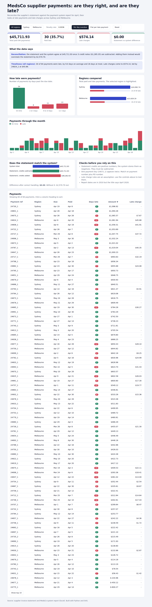

# MedsCo supplier payment reconciliation

An Excel reconciliation of a supplier invoice statement against a payment system report, with an interactive dashboard.



## What it shows
- The statement and system totals agree at $45,711.93 once credit notes are subtracted. Adding them would overstate the statement by $2,570.70.
- 30 of 84 payments (35.7%) were late, by 9 days on average.
- One payment key (`24673_1`) appears twice, so matching should use payment number plus PO number.
- Late charges depend on an assumption (penalty rate applied per day overdue). The dashboard lets you test a flat charge instead.

## Files
- `data/111_-_Combining_Text_Data_analysed.xlsx`: the workbook with the template formulas completed and a checks block
- `build.py` and `template.html`: read the workbook and generate the dashboard
- `index.html`: the finished dashboard (open it in a browser; it works offline)

## Rebuild
```
pip install openpyxl
python build.py
```

## Assumptions
Credits are subtracted. Late charge = amount x penalty rate x days overdue, on positive amounts only. Report dates are in 2010 although the title says April 2020.
